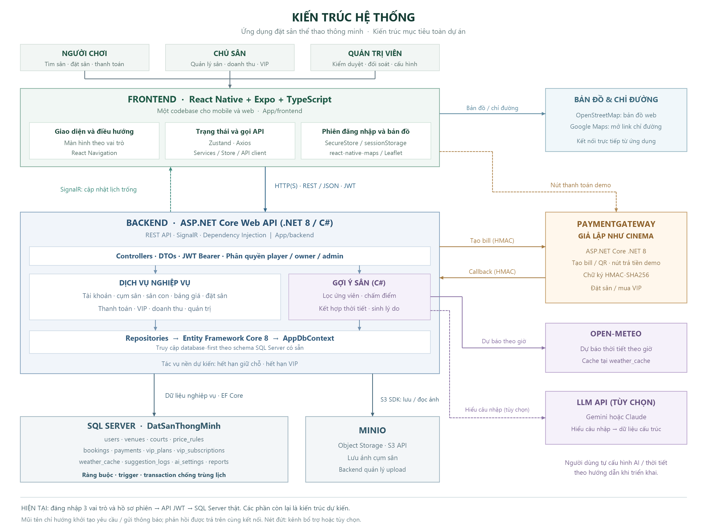

# Kiến trúc hệ thống đặt sân thể thao thông minh

Đây là kiến trúc mục tiêu của toàn bộ dự án, dựa theo cách tổ chức của The Sun Cinema. Hiện đã triển khai frontend đăng nhập cho ba vai trò, API đăng nhập/JWT và đọc hồ sơ phiên bằng SQL Server thật. Các nghiệp vụ và tích hợp còn lại được triển khai lần lượt sau khi duyệt từng màn hình.

## Bảng kiến trúc

| Thành phần | Công nghệ | Trách nhiệm | Kết nối |
| --- | --- | --- | --- |
| Người sử dụng | Người chơi, chủ sân, quản trị viên | Truy cập chức năng theo một vai trò của tài khoản | Cùng ứng dụng frontend trên mobile và web |
| Frontend | React Native, Expo, TypeScript, React Navigation | Giao diện và điều hướng theo vai trò | Axios gọi backend bằng HTTP(S), REST/JSON và JWT |
| Trạng thái và phiên | Zustand; Expo SecureStore trên mobile; sessionStorage trên web | Quản lý trạng thái, lưu và khôi phục phiên đăng nhập | Lấy hồ sơ và vai trò thật từ backend |
| Bản đồ | react-native-maps trên mobile; Leaflet + OpenStreetMap trên web | Hiển thị sân, vị trí; mở liên kết chỉ đường Google Maps | Kết nối từ frontend tới dịch vụ bản đồ tương ứng |
| API và xác thực | ASP.NET Core Web API .NET 8, C#, JWT Bearer, bcrypt | Nhận yêu cầu, kiểm tra dữ liệu và phân quyền player/owner/admin | Controllers → Services; mật khẩu được kiểm tra bằng hash bcrypt trong bảng users |
| Dịch vụ nghiệp vụ | C# Services, Dependency Injection | Quản lý tài khoản, sân, giá, đặt sân, thanh toán, VIP, doanh thu và quản trị | Repositories, MinIO và PaymentGateway |
| Gợi ý sân thông minh | Module Recommendation bằng C# trong backend | Lọc sân, chấm điểm khoảng cách/giờ/thời tiết/lịch sử/giá, sinh lý do gợi ý | SQL Server; Open-Meteo; LLM tùy chọn |
| Truy cập dữ liệu | Repositories, EF Core 8, AppDbContext | Đọc/ghi theo schema có sẵn; phối hợp transaction | SQL Server; không tự tạo/sửa schema bằng EF migrations |
| Cơ sở dữ liệu | SQL Server, database DatSanThongMinh | Lưu 12 bảng nghiệp vụ; kiểm soát ràng buộc, chống trùng lịch | Chỉ backend truy cập database nghiệp vụ |
| Cập nhật thời gian thực | ASP.NET Core SignalR | Thông báo frontend làm mới lịch trống | Backend → frontend; SQL Server vẫn quyết định tính hợp lệ của lịch đặt |
| Tác vụ nền | Tác vụ chạy trong backend, dự kiến | Xử lý hết hạn giữ chỗ và gói VIP | Dịch vụ nghiệp vụ và SQL Server |
| Lưu ảnh | MinIO, S3 SDK | Lưu ảnh cụm sân | Backend quản lý upload/đọc ảnh |
| Cổng thanh toán | PaymentGateway riêng bằng ASP.NET Core .NET 8, giống Cinema | Tạo bill/QR, đối chiếu bill khi bấm nút thanh toán demo, gửi callback | Backend gọi tạo bill; app gọi user-pay; gateway callback về backend với chữ ký HMAC-SHA256 |
| Dịch vụ thời tiết | Open-Meteo | Cấp dự báo theo giờ cho tính điểm sân | Backend gọi khi cache thiếu/cũ; cache trong weather_cache |
| LLM tùy chọn | Gemini hoặc Claude API | Hiểu câu nhập và trả dữ liệu có cấu trúc | Backend gọi nếu được cấu hình; không thay thế thuật toán chấm điểm C# |

## Các luồng chính

1. Người dùng đăng nhập trên frontend. Backend kiểm tra thông tin trong `users`, trả JWT và hồ sơ. Vai trò do backend quyết định.
2. Frontend gửi yêu cầu nghiệp vụ bằng Axios. Backend kiểm tra quyền, xử lý trong Services rồi truy cập SQL Server qua Repositories và EF Core.
3. Khi thanh toán, backend lấy số tiền từ database, tạo payment và yêu cầu gateway tạo bill có chữ ký HMAC-SHA256. Frontend hiển thị QR và gọi nút thanh toán demo. Gateway gửi callback có chữ ký; backend kiểm tra, cập nhật payment/booking hoặc VIP trong transaction. Frontend đọc trạng thái từ backend để xác nhận kết quả.
4. Khi gợi ý sân, module C# đọc dữ liệu sân, vị trí, giờ trống, lịch sử và cấu hình từ database; bổ sung dự báo Open-Meteo; sau đó lọc, chấm điểm và sinh lý do. LLM chỉ hỗ trợ hiểu câu nhập khi được cấu hình.
5. SignalR thông báo thay đổi lịch cho frontend. Trigger, ràng buộc và transaction tại database vẫn kiểm soát chống trùng lịch.

Việc cấu hình và gọi API AI/thời tiết sẽ do người dùng thực hiện theo hướng dẫn khi đến chức năng đó. Việc tạo tài liệu này không cấu hình hoặc gọi các API bên ngoài.

## Tệp sơ đồ

- `kien-truc-he-thong.png`: ảnh để xem hoặc chèn báo cáo.
- `kien-truc-he-thong.svg`: bản vector để phóng to, xuất hình hoặc chỉnh sửa.
- `kien-truc-he-thong.mmd`: mã Mermaid có thể chỉnh sửa.
- Script tạo lại: `App/scripts/draw-system-architecture.ps1` (chạy từ PowerShell trên Windows).

Mũi tên trong hình biểu diễn hướng khởi tạo yêu cầu hoặc gửi thông báo. Phản hồi trả về trên cùng kết nối. Nét đứt biểu diễn kênh bổ trợ hoặc tùy chọn. Các kết nối AI/thời tiết và thanh toán trong hình là thiết kế dự kiến.
