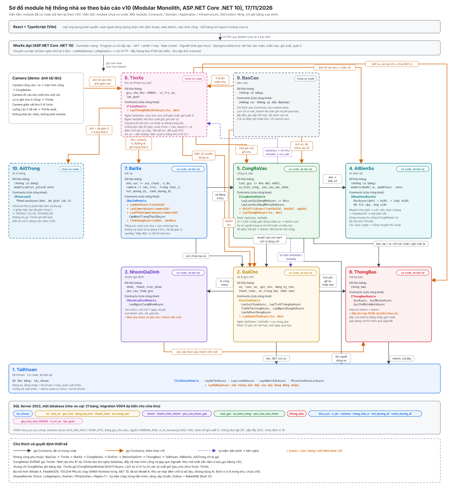

# Kiến trúc theo module (Modular Monolith, Buổi 12)

Cập nhật 17/11/2026: thiết kế lại **theo báo cáo v10** (chia khu, camera lối vào khu, 3 mô hình: Model A, PaddleOCR, YOLOv8 PKLot;
bỏ Model B). Đây là **thiết kế đích**: code hiện có của 7 module sẽ làm lại theo đây. Bản 16/11 (quét biển từng ô bằng camera trên cao)
đã bỏ, lưu ở `_sao-luu/`.

Một ứng dụng ASP.NET Core 10 chạy chung một tiến trình, nhưng chia thành các **module** độc lập. Mỗi module có tầng
`Domain / Application / Infrastructure` riêng (Clean Architecture, Buổi 4), **DbContext riêng**, và chỉ nói chuyện với module
khác qua project **`Contracts`** (interface công khai + record + sự kiện). Sau này muốn tách một module thành service riêng
(REST / gRPC / RabbitMQ) thì chỉ thay phần cài đặt của interface trong `Contracts`, code gọi không đổi.



Hình 1. Sơ đồ module theo v10. Viền liền: module đã có code (sẽ làm lại). Viền đứt: chưa có code. Mũi tên xám: gọi đã có trong code;
cam: gọi thêm theo v10; đứt tím: sự kiện. (Bản vector: [`so-do/so-do-module.svg`](so-do/so-do-module.svg).)

Hình luồng từng module (thiết kế theo v10, mỗi bước ghi API / Contracts):

| Module | Hình |
|---|---|
| 1. TaiKhoan: đăng ký, đăng nhập 1 máy, quên mật khẩu, mã đẩy, Admin khoá tài khoản | [`so-do/luong-1-tai-khoan.png`](so-do/luong-1-tai-khoan.png) |
| 2. GoiCho: thêm xe, duyệt, mua gói, nhắc hạn 3 mốc, phí quá hạn, huỷ gói, gỡ xe | [`so-do/luong-2-goi-cho.png`](so-do/luong-2-goi-cho.png) |
| 3. NhomGiaDinh: tạo nhóm, mã mời, xin vào, duyệt, dùng chung xe | [`so-do/luong-3-nhom-gia-dinh.png`](so-do/luong-3-nhom-gia-dinh.png) |
| 4 + 5. AiBienSo + CongRaVao: xe vào cổng (ngưỡng 0,85, thủ công khi AI lỗi), rồi TimXe chỉ dẫn khu | [`so-do/luong-4-5-xe-vao.png`](so-do/luong-4-5-xe-vao.png) |
| 5. CongRaVao: xe ra, người có quyền dùng xe trả lời trước có hiệu lực, trả phí rồi mới mở | [`so-do/luong-5-xe-ra.png`](so-do/luong-5-xe-ra.png) |
| 6. ThongBao: hộp thư, FCM, SignalR | [`so-do/luong-6-thong-bao.png`](so-do/luong-6-thong-bao.png) |
| 7. BaiXe: khu, sức chứa, ô, camera và vai trò, đa giác ô, lối đi | [`so-do/luong-7-bai-xe.png`](so-do/luong-7-bai-xe.png) |
| 8a. TimXe: chỉ dẫn khu + giữ suất 5 phút, camera lối vào khu ghi xe vào / ra khu | [`so-do/luong-8a-chi-dan-khu.png`](so-do/luong-8a-chi-dan-khu.png) |
| 8b. TimXe: tìm xe, dẫn đường, "Đã đỗ xe", đối soát, quét ô trống khu ô tô | [`so-do/luong-8b-tim-xe.png`](so-do/luong-8b-tim-xe.png) |
| 9. BaoCao: thống kê, lịch sử ra vào | [`so-do/luong-9-bao-cao.png`](so-do/luong-9-bao-cao.png) |

## 1. Danh sách module của đồ án

| # | Module | Trả lời câu hỏi | Sở hữu bảng | Contracts (cửa công khai); **đậm** = thêm theo v10 |
|---|---|---|---|---|
| 1 | TaiKhoan | Ai đang dùng hệ thống? | `tai_khoan` (+ mã đẩy của máy đăng nhập gần nhất) | `ITaiKhoanModule`: `LayHoTenAsync`, `LayLienHeAsync`, `LayAdminIdsAsync`, `PhienConHieuLucAsync`, **`LayMaDayAsync`** |
| 2 | GoiCho | Xe này được gửi không, gói còn hạn không, ai được dùng xe? | `xe`, `loai_xe`, `goi_cho`, `dang_ky_cho`, `thanh_toan`, `xe_trong_bai` (bản sao) | `IGoiChoModule`: `LaySucChuaAsync`, `LayTinhTrangXeAsync`, `TimXeTaiCongAsync` (**+ khớp gần đúng, loại xe**), `LayNguoiDungXeAsync`, `LayXeDuocDungAsync`, **`LayDoanhThuAsync`** |
| 3 | NhomGiaDinh | Ai được dùng chung xe? | `nhom`, `thanh_vien_nhom`, `yeu_cau_tham_gia` | `INhomGiaDinhModule`: `LayNguoiCungNhomAsync` |
| 4 | AiBienSo | Ảnh này là biển số gì? | (không bảng); `models/model_a`, PaddleOCR `.onnx` | `INhanDienBienSo.DocAsync(ảnh)` → biển, **loại biển**, độ tin cậy, ứng viên. Dùng cho cổng (CongRaVao) và lối vào khu (TimXe) |
| 5 | CongRaVao | Xe đang trong bãi hay đã ra? | `luot_gui` (giữ **khu mới nhất** `vi_tri_*`), `su_kien_cong`, `yeu_cau_xac_nhan` | `ICongRaVaoModule`: `LayLuotGuiDangMoAsync` (**+ khu**), `LayLuotGuiDangMoCuaXeAsync`, **`GhiViTriAsync(luotGuiId, khuId?, nguồn)`**, **`LayThongKeAsync`**; sự kiện `XeDaVao`, `XeDaRa` |
| 6 | ThongBao | Báo cho ai, báo gì? | `thong_bao` | `IThongBaoModule`: `GuiAsync`, `GuiNhieuAsync`, `GuiChoMoiAdminAsync` (**+ đẩy FCM, SignalR**) |
| 7 | BaiXe | Bãi chia khu thế nào, ô nào trống, đi lối nào? | `khu_vuc` (**+ `suc_chua`**), `o_do`, `camera` (**+ `vai_tro`**), `trang_thai_o`, `nut_duong_di`, `canh_duong_di` | `IBaiXeModule`: `CapNhatTrangThaiOAsync`, **`LayKhuAsync(loaiXeId)`**, **`LayCameraAsync`**, **`LayOTheoCameraAsync`**, **`TimDuongAsync(tuNut, denKhu)`** |
| 8 | TimXe | Xe vào khu nào, khu còn chỗ không, xe tôi ở đâu? | **`giu_cho_khu`** (V004), `vi_tri_xe`, `lan_quet` | `ITimXeModule`: **`LayThongKeDinhViAsync`** (cho BaoCao); nghe `XeDaVao`, `XeDaRa` |
| 9 | BaoCao | Doanh thu, lượt gửi, độ chính xác AI? | (không bảng) | (không có; không ai gọi BaoCao) |
| 10 | AiOTrong | Ô nào của khu ô tô đang trống? | (không bảng); `models/pklot_yolov8.onnx` | `IPhanLoaiO.PhanLoaiAsync(ảnh, đa giác các ô)` → `TRONG / CO_XE / KHONG_RO` từng ô |

**Lưu ý về module 10.** Báo cáo v10 viết `IPhanLoaiO` được cài trong Infrastructure của AiBienSo, nhưng bảng module của v10 vẫn tách
"10. AI ô trống". Thiết kế này **giữ 10 là module riêng** (không bảng, không trạng thái), vì đọc biển và phân loại ô là hai mô hình,
hai nhiệm vụ khác nhau; module nghiệp vụ vẫn chỉ phụ thuộc hai interface `INhanDienBienSo` và `IPhanLoaiO` như v10 yêu cầu. Nếu muốn
khớp chữ trong v10 thì gộp 10 vào 4, không đổi bên gọi.

## 2. Module nào hỏi module nào

| Bên gọi | Gọi | Để làm gì | |
|---|---|---|---|
| CongRaVao | `IGoiChoModule` | Xe ở cổng: khớp chính xác / gần đúng, đã duyệt, gói còn hạn, loại xe, nợ, ai được dùng xe | có, sửa |
| CongRaVao | `INhanDienBienSo` | Ảnh cổng → biển, loại biển, độ tin cậy (giới hạn 3 giây, lỗi → thủ công) | có, sửa |
| CongRaVao | `IThongBaoModule` | Xe vào, chờ xác nhận ra, đã ra, nghi mất xe, hết 60 giây | có |
| CongRaVao | `ITaiKhoanModule` | Tên người đã xác nhận ("Đã được [tên] xác nhận") | có |
| GoiCho | `INhomGiaDinhModule` | Ai cùng nhóm → ai có quyền dùng xe | có |
| GoiCho | `IThongBaoModule` | Nhắc hạn 72 giờ / lúc hết hạn / mỗi ngày quá hạn, huỷ gói, gỡ xe | có, thêm 2 mốc |
| GoiCho | `ITaiKhoanModule` | Tên, SĐT chủ xe | có |
| NhomGiaDinh | `IThongBaoModule` | Báo chủ nhóm có yêu cầu, báo người xin đã được duyệt | **thêm** |
| ThongBao | `ITaiKhoanModule` | Danh sách Admin, **mã đẩy** | có, thêm |
| BaiXe | `ICongRaVaoModule` | Số xe đang ở khu (không cho hạ sức chứa dưới số này) | có, sửa |
| BaiXe | `IGoiChoModule` | Sức chứa loại xe (tổng sức chứa các khu phải bằng) | có |
| TimXe | `ICongRaVaoModule` | Lượt mở + khu mới nhất; `GhiViTriAsync` khi xe vào / ra khu | **thêm** |
| TimXe | `IBaiXeModule` | Khu theo loại xe, camera, ô + đa giác, ghi trạng thái ô, đường đi | **thêm** |
| TimXe | `IGoiChoModule` | Biển số xe đang trong bãi; người hỏi có quyền dùng xe không | **thêm** |
| TimXe | `INhanDienBienSo` | Ảnh camera lối vào khu → biển | **thêm** |
| TimXe | `IPhanLoaiO` | Quét ô trống khu ô tô mỗi 2 phút / "Quét ngay" | **thêm** |
| TimXe | `IThongBaoModule` | "Mời vào khu B", biển lạ, sai loại khu, chưa định vị, khu đầy | **thêm** |
| BaoCao | `ICongRaVaoModule`, `IGoiChoModule`, `ITimXeModule` | Lượt vào / ra, độ chính xác AI; doanh thu; tỉ lệ xe được ghi khu | **thêm** |

**Sự kiện** (mũi tên đứt tím):

| Bên phát | Sự kiện | Bên nghe | Làm gì |
|---|---|---|---|
| CongRaVao | `XeDaVao` | GoiCho | Ghi `xe_trong_bai` (có) |
| CongRaVao | `XeDaVao` | TimXe | Chọn khu, giữ suất 5 phút, đẩy "Mời vào khu B" lên màn hình cổng + app |
| CongRaVao | `XeDaRa` | GoiCho | Xoá `xe_trong_bai` (có) |
| CongRaVao | `XeDaRa` | TimXe | Kết thúc suất giữ, ghi lịch sử ra (khu trong `luot_gui` đã được CongRaVao xoá khi đóng lượt) |

Không có vòng phụ thuộc. Xếp lớp từ "gọi nhiều" xuống "chỉ bị gọi":
BaoCao → TimXe → BaiXe → CongRaVao → GoiCho → NhomGiaDinh → ThongBao → TaiKhoan; AiBienSo và AiOTrong chỉ bị gọi.

**Ba quyết định để giữ không vòng** (nên nói được khi bảo vệ):

1. **CongRaVao không gọi TimXe.** Chỉ dẫn khu (UC-U22) chạy khi TimXe nghe `XeDaVao`; TimXe tự đẩy "Mời vào khu B" qua SignalR.
   Nếu CongRaVao gọi TimXe để lấy khu thì vòng (TimXe đã gọi CongRaVao). Hệ quả: chữ "Mời vào khu B" hiện sau barrier mở chừng
   vài trăm mili giây, chấp nhận được.
2. **Khu mới nhất nằm ở `luot_gui` (đúng v10), nhưng chỉ CongRaVao ghi**, qua `ICongRaVaoModule.GhiViTriAsync`. TimXe giữ lịch sử
   (`vi_tri_xe`) và suất giữ (`giu_cho_khu`). Không module nào UPDATE bảng của module khác.
3. **Lối đi thuộc BaiXe** (`TimDuongAsync`): BaiXe là cấu hình bãi, TimXe dùng để chọn khu gần nhất và dẫn đường.

```
Api (controller mỏng; Program.cs chỉ lắp ráp; PhatSuKienTrongTienTrinh; SignalR hub; BackgroundService: hết hạn xác nhận,
     nhắc hạn, hết hạn suất giữ, chưa định vị 15 phút, quét ô trống 2 phút)
 ├─ TaiKhoan     {Contracts, Domain, Application, Infrastructure}
 ├─ GoiCho       → Contracts của TaiKhoan, NhomGiaDinh, ThongBao (+ CongRaVao.Contracts chỉ để lấy kiểu sự kiện)
 ├─ NhomGiaDinh  → Contracts của ThongBao
 ├─ AiBienSo     → ONNX Runtime + SkiaSharp, Model A + PaddleOCR, không bảng
 ├─ AiOTrong     → ONNX Runtime + SkiaSharp, YOLOv8 PKLot, không bảng                                [chưa có code]
 ├─ CongRaVao    → Contracts của GoiCho, AiBienSo, ThongBao, TaiKhoan
 ├─ ThongBao     → Contracts của TaiKhoan (+ FCM, SignalR)
 ├─ BaiXe        → Contracts của CongRaVao, GoiCho
 ├─ TimXe        → Contracts của CongRaVao, BaiXe, GoiCho, AiBienSo, AiOTrong, ThongBao                [chưa có code]
 └─ BaoCao       → Contracts của CongRaVao, GoiCho, TimXe                                                [chưa có code]
Mọi Domain chỉ tham chiếu SharedKernel (IClock, LoiNghiepVu, ISuKien / IPhatSuKien / INghe<T>).
```

Luật (kiểm được bằng cách mở file `.csproj` và câu SQL trong `Infrastructure`):

1. `Domain` không tham chiếu project nào ngoài `SharedKernel`.
2. `Application` của module A **không** tham chiếu `Application`/`Domain`/`Infrastructure` của module B, chỉ `B.Contracts`.
3. Mỗi module một `DbContext`; câu SQL trong `Infrastructure` của module chỉ đụng bảng của module đó (ngoại lệ ở dưới).
4. **Không module nào GHI vào bảng của module khác.** TimXe không UPDATE `luot_gui` hay `trang_thai_o`, mà gọi Contracts.
5. Việc làm **sau khi lưu** (phát sự kiện, gửi thông báo) lỗi thì ghi log, không làm hỏng kết quả đã lưu. Bên nghe được thử lại 3 lần.
6. Frontend: trang trong `modules/x` chỉ import từ `modules/x`, `shared/` và `app/`.

### Ngoại lệ còn lại (có chủ đích, chỉ ĐỌC)

| Đối tượng | Đọc bảng của | Vì sao giữ |
|---|---|---|
| `v_cho_con_ban`, `sp_mua_goi`, `sp_doi_suc_chua` (GoiCho, SQL) | `luot_gui` (CongRaVao) | "Xe hết gói còn trong bãi vẫn chiếm suất": phải đếm dưới cùng khoá với lúc bán |
| `fn_phi_qua_han`, `sp_thanh_toan_phi_qua_han` (GoiCho, SQL) | `luot_gui` (CongRaVao) | Tính và trả phí trong một giao dịch |
| `sp_huy_goi`, `sp_go_xe` (GoiCho, SQL) | `luot_gui` (CongRaVao) | Kiểm tra lại "xe trong bãi" dưới khoá |
| `sp_thanh_toan_phi_qua_han` (GoiCho, SQL) | `thanh_vien_nhom` (NhomGiaDinh) | Kiểm tra quyền dùng xe trong giao dịch trả phí |
| `cau_hinh` (mọi module cần tham số) | bảng cấu hình chung | Chỉ đọc; giá trị sai thì dùng mặc định và ghi log |

Khoá ngoại giữa bảng của hai module (vd. `giu_cho_khu.luot_gui_id` → `luot_gui`) vẫn giữ: đó là ràng buộc dữ liệu trong cùng một
database. Cách chuẩn hơn cho sự kiện là Outbox + RabbitMQ (Buổi 12), để ở phần nâng cao.

## 2a. Thiết kế module 8, TimXe

| Tầng | Thành phần | Việc |
|---|---|---|
| Domain | `ChonKhu` | Chỗ còn = sức chứa − xe trong khu − suất `DANG_GIU`; chọn khu đúng loại xe còn chỗ, đường ngắn nhất từ cổng |
| Domain | `KhopBienKhu` | Chỉ so với xe có lượt mở: chính xác, rồi lệch ≤ 1 ký tự với đúng 1 ứng viên |
| Domain | `XacDinhHuong` | Cùng biển cùng khu trong 30 giây → bỏ; chưa ghi ở khu = VÀO, đang ghi ở khu = RA; đang ở khu khác → chuyển hẳn |
| Domain | `MucChoCon` | "Còn nhiều" / "Sắp đầy" (≤ 20%) / "Đầy" |
| Application | `NgheXeDaVao`, `NgheXeDaRa` | Tạo / kết thúc suất giữ; đẩy "Mời vào khu B" |
| Application | `XuLyAnhLoiVaoKhuUseCase` | Đọc biển → khớp → hướng → `vi_tri_xe` + `ICongRaVaoModule.GhiViTriAsync`; sai loại khu, biển lạ, tin cậy thấp → báo / đối soát |
| Application | `DaDoXeUseCase` | "Đã đỗ xe" / QR lối vào khu: chưa có khu → ghi `NGUOI_DUNG`; camera đã ghi khu khác → tin camera, báo Admin |
| Application | `DoiSoatUseCases` | Danh sách chưa định vị (15 phút), biển lạ, sai loại khu, ảnh tin cậy thấp; Admin gán / gỡ từng xe (`ADMIN`) |
| Application | `TimXeCuaToiUseCase` | Kiểm quyền (`LayXeDuocDungAsync`) → khu, giờ vào khu, ảnh → `TimDuongAsync` |
| Application | `QuetOTrongUseCase` | Mỗi camera `GIAM_SAT`: ảnh + đa giác → `IPhanLoaiO` → `CapNhatTrangThaiOAsync`; ghi `lan_quet` |
| Infrastructure | `TimXeDbContext` | `giu_cho_khu`, `vi_tri_xe`, `lan_quet` |
| Api | `TimXeController`, 3 `BackgroundService` | Hết hạn suất giữ, chưa định vị, quét ô trống (2 phút, "Quét ngay") |

**Chưa chốt (v10 để trống):** định vị ô tô tới từng ô. PKLot chỉ cho biết ô trống / có xe, không biết xe nào; muốn biết xe nào ở ô
nào thì phải đọc biển từ camera trên cao, đúng hướng Model B đã bỏ. Hiện thiết kế chỉ định vị ô tô ở **mức khu**, như xe máy.

## 2b. Thiết kế module 10, AiOTrong

Không bảng, không trạng thái, chỉ một cửa `IPhanLoaiO.PhanLoaiAsync(ảnh, đa giác các ô)`. Bên trong: YOLOv8 PKLot (ONNX, 640) →
hộp `space-empty` / `space-occupied` → ghép tâm hộp vào đa giác ô (nhiều hộp thì chọn hộp phủ nhiều nhất) → không hộp nào thì
`KHONG_RO`. Lịch quét, ghi trạng thái ô thuộc TimXe (theo bảng module v10). Rủi ro cần đo: PKLot là bãi ô tô Brazil, góc cao; phải đo
lại trên video bãi trường (7,4% ô có xe bị đoán trống trên tập kiểm định PKLot).

## 2c. Thiết kế module 9, BaoCao

Không bảng, không Contracts. `BaoCaoController` (chỉ Admin) gọi `ICongRaVaoModule.LayThongKeAsync` (lượt vào / ra, từ chối theo lý do,
tỉ lệ Admin phải sửa biển), `IGoiChoModule.LayDoanhThuAsync` (bán gói + phí quá hạn − hoàn), `ITimXeModule.LayThongKeDinhViAsync`
(tỉ lệ xe được ghi khu theo nguồn). Không SQL đọc thẳng bảng module khác.

## 2d. Việc phải sửa ở 7 module đã có (khi làm lại code)

| Module | Sửa gì |
|---|---|
| TaiKhoan | Lưu mã đẩy khi đăng nhập (ghi đè máy cũ), `LayMaDayAsync`; Admin xem / khoá / mở khoá tài khoản |
| GoiCho | Nhắc lúc hết hạn và mỗi ngày quá hạn; người có quyền dùng xe trả được phí quá hạn; `TimXeTaiCongAsync` khớp gần đúng + trả loại xe; `LayDoanhThuAsync` |
| NhomGiaDinh | Gọi `IThongBaoModule` khi có yêu cầu / được duyệt |
| AiBienSo | `DocAsync` trả thêm loại biển; giới hạn 3 giây |
| CongRaVao | Ngưỡng 0,85 → Admin xác nhận; chế độ thủ công; **xe ra: người có quyền dùng xe trả lời trước có hiệu lực** (bỏ bắt buộc Admin đồng ý), gói hết hạn → trả phí rồi mới mở, hết 60 giây → Admin; `GhiViTriAsync`, `LayThongKeAsync` |
| ThongBao | Đẩy FCM theo mã đẩy, SignalR khi app đang mở |
| BaiXe | `suc_chua` khu, `vai_tro` camera, trang vẽ đa giác ô, lối đi + `TimDuongAsync`, `LayKhuAsync`, `LayCameraAsync`, `LayOTheoCameraAsync`; bỏ phần "xe đang đỗ ô nào" |
| Database V004 | `khu_vuc.suc_chua`; `camera.vai_tro` (`LOI_VAO_KHU` / `GIAM_SAT`); bảng `giu_cho_khu`; nguồn `CAMERA_KHU`; `vi_tri_xe.huong` (`VAO` / `RA`); `cau_hinh`: `phut_giu_cho_khu`=5, `giay_chong_doc_lap`=30, `phan_tram_sap_day`=20, `phut_chua_dinh_vi`=15 |

## 3. Cấu trúc thư mục

```
models/                             model_a_yolov8n.onnx, paddleocr_rec_bien_so.onnx, dict_bien_so.txt, README.md
                                    (+ pklot_yolov8.onnx khi làm module 10)
backend/
  global.json                       .NET SDK 10
  src/
    SharedKernel/                   IClock, LoiNghiepVu, ISuKien / IPhatSuKien / INghe<T> (dùng chung, không có nghiệp vụ)
    (sẽ thêm) Camera/               NhaXe.Camera: đọc khung hình RTSP / video / ảnh mẫu (kỹ thuật, không có nghiệp vụ)
    Modules/
      TaiKhoan/ GoiCho/ NhomGiaDinh/ AiBienSo/ CongRaVao/ ThongBao/ BaiXe/
      (sẽ thêm) AiOTrong/ TimXe/ BaoCao/
        {Contracts, Domain, Application, Infrastructure}
    Api/
      Modules/{TaiKhoan, GoiCho, NhomGiaDinh, AiBienSo, CongRaVao, ThongBao, BaiXe}/*Controller.cs  (Swagger nhóm theo [Tags])
      Common/                        LoiMiddleware, NguoiDungHienTai, PhatSuKienTrongTienTrinh
      Program.cs                     chỉ lắp ráp: Add<TênModule>Module(...), JWT, Rate Limiter, Swagger
  tests/NhaXe.Tests/{TaiKhoan, GoiCho, NhomGiaDinh, AiBienSo, CongRaVao, ThongBao, BaiXe, GiaoTiepModule}/  + Fakes.cs
frontend/src/
  app/        App.tsx (route), Layout.tsx (menu), AppContext.tsx, container.ts (composition root)
  shared/     api/httpClient.ts, ui/, utils/format.ts, models.ts
  modules/{tai-khoan, goi-cho, nhom-gia-dinh, ai-bien-so, cong-ra-vao, thong-bao, bai-xe}/{pages, services, models.ts, index.ts}
docker/       api.Dockerfile, web.Dockerfile, nginx.conf, db-init.sh, certs/
```

## 4. Khuôn mẫu thêm một module mới (ví dụ TimXe)

Backend:

1. Tạo 4 project: `Modules/TimXe/Contracts`, `Domain` (→ SharedKernel), `Application` (→ Domain, Contracts của module cần hỏi),
   `Infrastructure` (→ Application, EF Core SqlServer). Lệnh: `dotnet new classlib -o src/Modules/TimXe/Domain -n NhaXe.Modules.TimXe.Domain` …, rồi `dotnet sln add`.
2. `Contracts/ITimXeModule.cs`: chỉ những gì module khác cần hỏi, kiểu trả về là `record`. Sự kiện module phát ra cũng đặt ở đây.
3. `Domain/`: quy tắc nghiệp vụ thuần (vd. `KhopBienSo`, vị trí cũ hơn N phút thì coi là chưa chắc), không biết DB.
4. `Application/`: interface lưu trữ, use case mỗi việc một class, `DependencyInjection`, cài đặt `ITimXeModule`.
   Cần biển số từ ảnh camera lối vào khu thì gọi `INhanDienBienSo`, cần sơ đồ thì gọi Contracts của BaiXe, không đọc bảng của họ.
5. `Infrastructure/`: `TimXeDbContext` (chỉ `giu_cho_khu`, `vi_tri_xe`, `lan_quet`), repository, `AddTimXeModule(connStr)`.
6. `Api/Modules/TimXe/*Controller.cs` có `[Tags("8. TimXe …")]`; `Program.cs` thêm `AddTimXeModule(connStr)`; `NhaXe.Api.csproj` thêm tham chiếu Infrastructure.
7. `tests/NhaXe.Tests/TimXe/`: test use case với bản giả của các module khác.
8. Cần biết xe vừa vào cổng thì nghe `XeDaVao` (`CongRaVao.Contracts`); cần báo người dùng thì gọi `IThongBaoModule`. Không gọi ngược module đang gọi mình.

Frontend:

1. `modules/tim-xe/{pages, services, models.ts, index.ts}`; service có interface `ITimXeService` + `ApiTimXeService`.
2. Thêm vào `app/container.ts`, route ở `app/App.tsx`, mục menu ở `app/Layout.tsx`.

## 5. Ví dụ đã làm theo khuôn: xe tới cổng vào bằng ảnh (CongRaVao + AiBienSo + GoiCho)

| Tầng | Vị trí | Việc |
|---|---|---|
| Api | `Api/Modules/CongRaVao/AdminCongController.cs` | `POST /api/admin/cong/vao/anh` (multipart, ≤ 5 MB) → `XeVaoUseCase` |
| Application | `CongRaVao/Application/Interfaces.cs` | `NhanDienBangAi`: biển gõ tay ưu tiên, không có thì gọi `IAiBienSoModule.DocAsync` |
| Module khác | `AiBienSo/Infrastructure/MoHinhDocBienSoOnnx.cs` | Model A tìm biển → PaddleOCR đọc 1 dòng và 2 dòng → chọn cách đúng định dạng biển VN |
| Application | `CongRaVao/Application/XeVaoRaUseCases.cs` | Hỏi `IGoiChoModule.TimXeTaiCongAsync`: chưa đăng ký / chưa duyệt / hết gói / đang trong bãi thì từ chối |
| Domain | `CongRaVao/Domain/LuotGui.cs`, `SuKienCong.cs` | Mở lượt gửi, ghi nhật ký cổng (cả khi từ chối) |
| Infrastructure | `CongRaVao/Infrastructure/CongRaVaoRepository.cs` | Lưu lượt gửi + nhật ký trong một transaction |
| Sau khi lưu | `IPhatSuKien` + `IThongBaoModule` | Phát `XeDaVao` (GoiCho cập nhật `xe_trong_bai`), báo người dùng xe; lỗi chỉ ghi log |
| Test | `tests/.../CongRaVao/CongRaVaoUseCaseTests.cs`, `AiBienSo/MoHinhOnnxTests.cs` | Use case với bản giả; mô hình thật trên 6 ảnh mẫu |

## 6. Ví dụ đã làm theo khuôn: Admin đổi giá gói (module GoiCho)

| Tầng | Vị trí | Việc |
|---|---|---|
| Domain | `GoiCho/Domain/GoiCho.cs` | `DoiGia`: > 0, ≤ 1 tỷ, tròn nghìn; `KiemTraGiaKhachThay`: khác giá hiện tại thì lỗi 409 `GIA_DA_DOI` |
| Application | `AdminUseCases.cs` | `LayBangGiaAdminUseCase`, `DoiGiaGoiUseCase`; `MuaGoiUseCase` kiểm `giaKhachThay` **trước khi thu tiền** |
| Infrastructure | `Repositories.cs` | `TimDeSuaAsync` + `LuuAsync` (EF theo dõi thay đổi, UPDATE `goi_cho.gia`) |
| Api | `AdminGoiChoController` | `GET /api/admin/goi-cho`, `PUT /api/admin/goi-cho/{id}/gia` |
| Frontend | `goi-cho/pages/AdminGoiGiaPage.tsx`, `MuaGoiPage.tsx` | Admin sửa giá tại chỗ; khách gửi giá đang thấy, bị đổi giá thì bảng giá tải lại |
| Test | `tests/.../GoiCho/DoiGiaGoiTests.cs` | Giá sai, gói không có, mua theo giá cũ bị chặn và không thu tiền |

Giá mới chỉ áp cho lần mua sau: `dang_ky_cho.so_tien` lưu số tiền lúc mua, hoàn tiền khi huỷ tính theo số đó.
